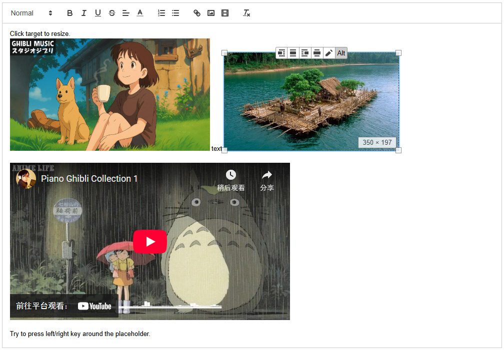

# Quill Resize Module

A Quill 2 module for resizing images, videos, iframes, and custom embeds. Supports mouse/touch handles, size limits, aspect ratios, toolbar actions, and keyboard navigation.

Originally forked from [quill-image-resize-module](https://github.com/whatcould/quill-image-resize-module).

[Live demo](https://codesandbox.io/p/sandbox/9m9vl8)



## Installation

```sh
npm install quill@^2 quill-resize-module
```

## Quick Start

### ES Modules / Bundlers

Add `<div id="editor"></div>` to your page:

```javascript
import Quill from 'quill';
import QuillResize from 'quill-resize-module';
import 'quill/dist/quill.snow.css';
import 'quill-resize-module/dist/resize.css';

Quill.register('modules/resize', QuillResize);

const quill = new Quill('#editor', {
  theme: 'snow',
  modules: {
    toolbar: [
      ['bold', 'italic'],
      ['link', 'image', 'video'],
    ],
    resize: {
      // See Configuration below for optional settings.
    },
  },
});
```

### Script Tags

Load Quill first; `resize.js` automatically registers the module with `window.Quill`. Adjust asset paths to your application.

```html
<link rel="stylesheet" href="/node_modules/quill/dist/quill.snow.css" />
<link
  rel="stylesheet"
  href="/node_modules/quill-resize-module/dist/resize.css"
/>

<div id="editor"></div>

<script src="/node_modules/quill/dist/quill.js"></script>
<script src="/node_modules/quill-resize-module/dist/resize.js"></script>
<script>
  const quill = new Quill('#editor', {
    theme: 'snow',
    modules: { resize: {} },
  });
</script>
```

## Formats

The module automatically registers these toolbar formats. Both accept `left`, `center`, `right`, and `full`:

| Format          | Applies to                                 |
| --------------- | ------------------------------------------ |
| `resize-inline` | Inline embeds, such as images              |
| `resize-block`  | Block embeds, such as Quill's video iframe |

If you set Quill's top-level `formats` allowlist, include both alongside your existing formats so toolbar formatting is applied and preserved:

```javascript
// Run after the imports and module registration shown in Quick Start.
const quill = new Quill('#editor', {
  // Keep every format your editor uses.
  formats: [
    'image',
    'video',
    'resize-inline', // Inline embed alignment and full width
    'resize-block', // Block embed alignment and full width
  ],
  modules: { resize: {} },
});
```

With the default registry, omitting `formats` allows all registered formats. With a custom `registry`, register `Quill.import('formats/resize-inline')` and `Quill.import('formats/resize-block')` there; Quill ignores `formats` in that case.

Keep `resize.css` loaded when rendering saved HTML for the `ql-resize-style-*` classes.

## Configuration

Defaults and optional callbacks, passed to `modules.resize`:

```javascript
const resizeOptions = {
  // Enable feature modules: size display, toolbar, drag handles, keyboard.
  modules: ['DisplaySize', 'Toolbar', 'Resize', 'Keyboard'],
  keyboardSelect: true, // Enable arrow-key selection

  // CSS classes for elements in a selection and the active resize target.
  selectedClass: 'selected',
  activeClass: 'active',

  // Disable native pointer events on these tags to allow resize selection.
  embedTags: ['VIDEO', 'IFRAME'],
  tools: ['left', 'center', 'right', 'full', 'edit'],

  // Configure resizable elements by Quill blot name, not HTML tag.
  parchment: {
    image: {
      attribute: ['width'], // Adjustable dimensions
      limit: {
        minWidth: 100, // Minimum width in pixels
        // Optional pixel limits: maxWidth, minHeight, maxHeight.
      },
    },
    video: {
      attribute: ['width', 'height'],
      limit: {
        minWidth: 200,
        ratio: 0.5625, // height / width: 9 / 16 for a 16:9 element
      },
    },
  },

  // Triggered when an element is activated.
  onActive(blot, target) {},
  // Triggered when an element is deactivated.
  onInactive(blot, target) {},
  // Triggered when a resize drag ends; size contains width and/or height in pixels.
  onChangeSize(blot, target, size) {},
};
```

- Options merge at the top level: `parchment` and arrays replace their defaults. Include every blot you want to resize.
- For handles and size display only, use `modules: ['Resize', 'DisplaySize']`. `keyboardSelect: false` disables arrow-key selection; omit `Keyboard` to remove active-element navigation and Backspace/Delete handling.
- Height limits apply when height is adjusted or calculated from `ratio`. Elements narrower than `minWidth` cannot activate the overlay.
- Style `selectedClass` and `activeClass` in your CSS. Regular callback functions receive the resize instance as `this`, with access to `this.quill`.

For custom embeds, register a blot that preserves width/height, add its name to `parchment` and any `formats` allowlist, and add its tag to `embedTags` if native pointer events need disabling.

## Custom Toolbar Buttons

Built-in tools are `left`/`right` (float), `center`, `full` (full width), and `edit` (close the overlay and select the embed). Click an active layout button again to clear its formatting.

Mix built-in names and custom buttons in `modules.resize.tools`:

```javascript
const tools = [
  'left',
  'center',
  'right',
  'full',
  'edit',
  {
    text: 'Alt', // Button text
    // Custom button attributes
    attrs: {
      title: 'Set image alt text',
      class: 'btn-alt',
    },
    // Button display condition
    verify(activeEle) {
      return activeEle.tagName === 'IMG';
    },
    // Button click handler
    handler(evt, button, activeEle) {
      const alt = window.prompt(
        'Image alt text',
        activeEle.getAttribute('alt') || '',
      );
      if (alt !== null) {
        activeEle.setAttribute('alt', alt);
      }
    },
  },
];
```

Use `icon` for HTML markup or `toolClass` for a built-in layout value. Return `false` from `verify` to hide a button. When combining `handler` with `toolClass`, return `true` from the handler to continue formatting and update the overlay.

## Custom Modules

Extend `QuillResize.Modules.Base` and include the class in `modules.resize.modules`:

```javascript
class MyModule extends QuillResize.Modules.Base {
  onCreate() {
    // Create controls when an element becomes active.
  }

  onUpdate() {
    // Keep controls in sync with the active element.
  }

  onDestroy() {
    // Release listeners and resources when the element becomes inactive.
  }
}

const quill = new Quill('#editor', {
  modules: {
    resize: {
      modules: [MyModule, QuillResize.Modules.Resize],
    },
  },
});
```

The base class provides `quill`, `resizer`, `overlay`, `activeEle`, `blot`, and `options`. Call `requestUpdate()` after layout changes. See [BaseModule.ts](./src/modules/BaseModule.ts) for lifecycle details.

## Migrating to v2

- Supports Quill 2.
- Removes the module's `formats/image` and `formats/placeholder`; use Quill's image blot or your own.
- Replaces `options.styles` with CSS customization.
- Adds `embedTags` and `tools`. Include `resize-inline` and `resize-block` in any `formats` allowlist.

## License

[MIT](./LICENSE)
